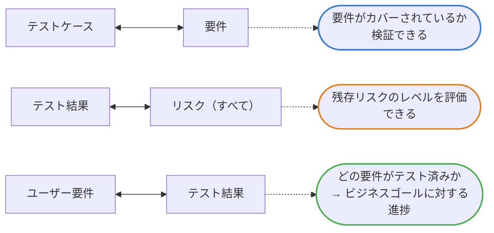
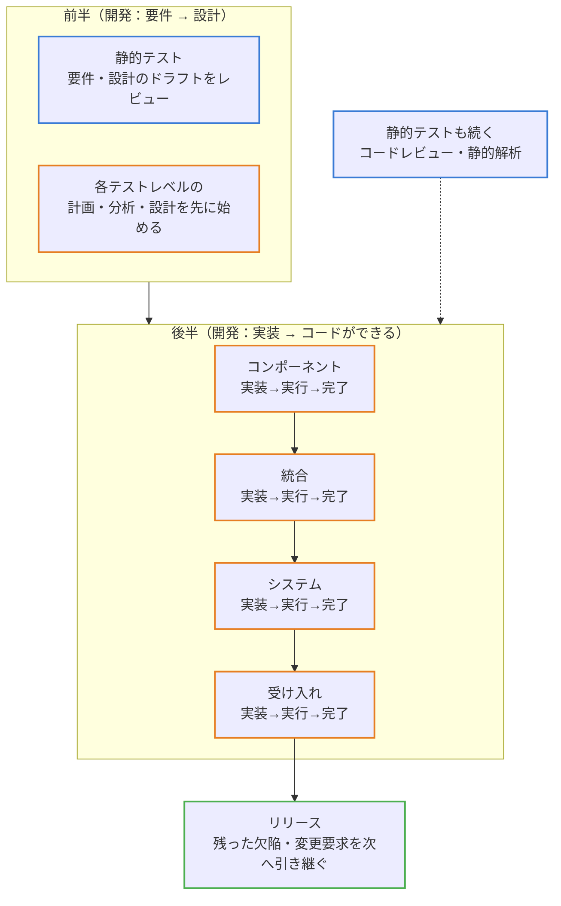
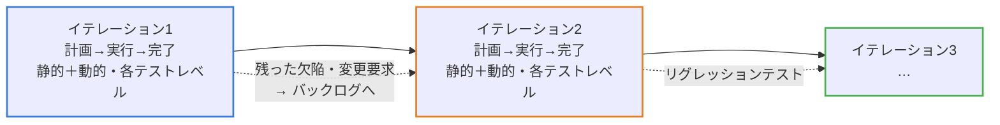

# 公式サンプルB メモ

`*` 付き問題の解説を、問題番号順に残す。

## 問題1（正解 D・シラバス 1.2.1）

**問われていること**：「テストが必要な理由」＝テストがプロジェクトの成功にどう役立つか（1.2.1）。ここでの「テスト」には**静的テスト（レビュー）も含まれる**。

| 選択肢 | 判定 | 理由 |
| --- | --- | --- |
| A | × | ユーザーが**絶対に起こせない**故障を見つけても価値が低い。テストはエンドユーザーのために品質を上げるのが目的 |
| B | × | 静的テストが見つけるのは**欠陥**。「故障」は動的テストで見つかる |
| C | × | 静的解析の結果は**開発担当者向け**。顧客にリリース適合の証拠を示すものではない |
| D | ○ | レビューで要求仕様書の欠陥を早く取り除けば、設計・コードなど後の作業成果物の手戻りが減る |

**迷ったポイント**：「テストってレビューがメインじゃないのでは？」
→ JSTQB では **テスト＝動的テスト＋静的テスト**（1.1.1）。レビューも立派なテスト活動なので、D は「テストが必要な理由」の例になる。

**C の補足**：静的解析はコードの欠陥を**直接見つける**もの。その情報は開発担当者が直すために使う（顧客向けではない）→ リリース適合の証拠を顧客に示す、は誤り。

## 問題6（正解 B・シラバス 1.4.4）トレーサビリティ

**何と何をつなぐと、何が分かるか**

**ほかの価値**（組み合わせの指定なし）：変更の影響を判断／監査が楽／IT ガバナンスの基準を満たす／進捗・完了レポートが分かりやすい／ステークホルダーに伝えやすい

**誤答パターン**

| 選択肢 | つなぐもの | 誤りの理由 |
| --- | --- | --- |
| A | **軽減された**リスク ⇔ **合格した**テスト | 片付いたもの同士で情報がほぼない。残存リスクは**すべての**リスク ⇔ テスト結果で見る |
| C | テスト担当者 ⇔ 不合格テスト | スキル評価は価値ではない。数字に合わせて最適化され逆効果 |
| D | 識別されたリスク ⇔ テスト条件 | 分かるのは**追加で書くべきテスト条件**。テストする価値の判断はリスクマネジメント |

## 補足：SDLC とテストの流れ（シラバス 2.1.1・1.4.1）

- SDLC モデルはプロジェクトで**1つ選ぶ**もの。繰り返されるのは**テスト活動**（計画〜完了）
- テスト完了はマイルストーン（**リリース・イテレーションの終了・テストレベルの完了**など）で行い、未解決の欠陥・変更要求は**次へ引き継ぐ**
- 静的テストは初期が中心だが、**後のフェーズでも続く**（コードやテストケースができればレビュー・静的解析の対象）

### シーケンシャル

初期は要件レビュー・テスト分析・設計が中心。動的テストはコードができる後半から。

- 各テストレベル＝テストプロセス（計画〜完了）の**1回分**（2.2.1）
- 各テストレベルの**計画・分析・設計は前半（対応する開発フェーズの間）に始めておく**（2.1.1・2.1.3）
- 後半、コードができたら**実装 → 実行 → 完了**を進める。あるレベルの終了基準が次のレベルの開始基準の一部（2.2.1）

※矢印「コンポーネント → 統合」は、前のレベルの終了基準が次のレベルの開始基準の一部になる、という意味。

### イテレーティブ／インクリメンタル

各イテレーションで、静的・動的テストが**すべてのテストレベルで実行される可能性がある**。頻繁に提供するため、迅速なフィードバックと広範なリグレッションテストが必要。

※図はシラバスの記載をもとに作成したもの（図そのものはシラバスにない）。
