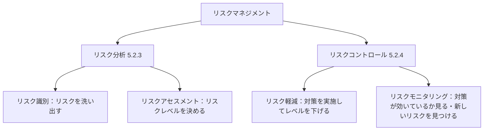
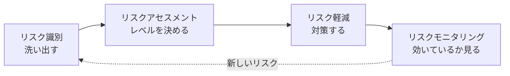

## テストウェアの覚え方（その活動が終わったとき手元に残っている物）

| 活動 | やること                   | 残る物（テストウェア）                                                                   |
| ---- | -------------------------- | ---------------------------------------------------------------------------------------- |
| 計画 | 段取りを決める             | テスト計画書                                                                             |
| モニタリングとコントロール | 進み具合を**見張って直す**（ほかの活動と並行して続く） | **テスト進捗レポート**（毎日・毎週など定期的）、コントロールのための指示の文書化、リスク情報 |
| 分析 | **何を**テストするか決める | テスト条件（「ロック機能」）、要件書の欠陥レポート                                       |
| 設計 | **どう**テストするか決める | テストケース（3回・4回失敗）、カバレッジアイテム、チャーター、データ・環境の**要件**     |
| 実装 | **準備**する               | 手順書、自動スクリプト、スイート、**実際の**テスト用アカウント、スタブ、実行スケジュール |
| 実行 | **やる**                   | テスト結果記録、欠陥レポート                                                             |
| 完了 | **振り返る**               | **テスト完了レポート**（テスト進捗レポートの情報を材料にして作る）、教訓、改善アクション、変更要求 |

合言葉：何を → どう → 準備 → やる → 振り返る

- 「〜の要件」→ 設計
- 「手順・スクリプト・スケジュール・実物」→ 実装
- 「レポート・教訓・改善」→ 完了
- 「進捗レポート」→ 主にモニタリングとコントロール、テスト完了でも材料として使う。計画・分析・設計では使わない（問題36）

要件R1 ─ テスト条件 ─ TC1・TC2 ─ 結果 ─ 欠陥#5

リスク ─┘

## アジャイル開発と開発モデル（シラバス2.1）

| 分類                           | 例                                          |
| ------------------------------ | ------------------------------------------- |
| シーケンシャル開発モデル       | ウォーターフォールモデル、V字モデル         |
| イテレーティブ開発モデル       | スパイラルモデル、プロトタイピング          |
| インクリメンタル開発モデル     | 統一プロセス                                |
| アジャイルプラクティス（手法） | スクラム、XP、カンバン、TDD、ATDD、BDD など |

- アジャイル：プロジェクトを通じて**変更が起こる前提**。文書化を軽くし、リグレッションテストのための**自動化を充実**させる（2.1.1）
- テストの四象限は**アジャイル開発のモデル**（5.1.7）。番号はやる順番ではなく分類。SDLC上の位置とは関係ない
- TDD・ATDD・BDD＝テストが開発を導くアプローチ（テスト技法ではない）。コードの前にテストを決める → 早期テスト、シフトレフト。**イテレーティブ開発モデルをサポートする**（2.1.3）

| アプローチ | 特徴                                                                    |
| ---------- | ----------------------------------------------------------------------- |
| TDD        | テストを最初に書く → テストを満たすコードを書く → リファクタリング      |
| ATDD       | 受け入れ基準からテストを導き、開発前に書く                              |
| BDD        | 振る舞いを Given/When/Then の自然言語で書き、実行可能なテストに自動変換 |

## 自動テストスクリプト

- テスト**実装**で作る（「手動および自動のテストスクリプトを作成する」1.4.3）
- 手順書の操作を、プログラムが代わりに実行するコード。一度書けば何回でも同じように実行できる
- **リグレッションテストは自動化の有力な候補**。早期に始めるべき。CI があれば自動リグレッションテストを含めるのがよい実践（2.2.3）
- どのテストをリグレッションにするかは**影響度分析**で決める。自動化するのは影響度分析ではなく**リグレッションテストの方**
- 全部自動化はしない（6.2のリスク：手動の方が適切な場合にツールを使う、スクリプト保守の見積りが甘い、批判的思考を無視する）

| 象限（5.1.7）                   | 含まれるテスト                     | 自動か手動か                   |
| ------------------------------- | ---------------------------------- | ------------------------------ |
| 第1（技術・チーム支援）         | コンポーネント、コンポーネント統合 | **自動化**して CI に含めるべき |
| 第2（ビジネス・チーム支援）     | 機能、ユーザーストーリー、API など | 手動でも自動でもよい           |
| 第3（ビジネス・プロダクト批評） | 探索的、使用性、ユーザー受け入れ   | **多くの場合手動**             |
| 第4（技術・プロダクト批評）     | スモーク、非機能（使用性は除く）   | しばしば自動化                 |

## テストレベルと担当者（シラバス2.2、公式サンプルC 問題8の解説より）

テストレベル＝テストを、開発の段階（部品から完成品まで）ごとにまとめたグループ（「系統的にまとめ、マネジメントしていくテスト活動のグループ」2.2）

| テストレベル             | 何をテストするか                         | 主に行う人                     |
| ------------------------ | ---------------------------------------- | ------------------------------ |
| コンポーネントテスト     | 部品1つ                                  | 開発担当者                     |
| コンポーネント統合テスト | 部品と部品のつながり                     | 開発担当者                     |
| システムテスト           | システム全体（仕様どおりか）             | テストチーム                   |
| システム統合テスト       | 他のシステムとのつながり                 | テストチーム                   |
| 受け入れテスト           | ユーザーのニーズを満たすか（妥当性確認） | ビジネス代表者・エンドユーザー |

|              | 分け方                     | 例                                   |
| ------------ | -------------------------- | ------------------------------------ |
| テストレベル | **段階**（部品 → 全体）    | コンポーネントテスト、システムテスト |
| テストタイプ | **何を見るか**（品質特性） | 機能テスト、非機能テスト             |

テストタイプのほとんどは、どのテストレベルでも実行できる（2.2）。

※「通常は」。状況によってはテスト担当者がコンポーネント（統合）テストを自動化することもある（問題11の解説）。

## テスト実装の成果物（シラバス1.4.3）

| 言葉                         | たとえ       | 中身（ログインの例）                                                                                  |
| ---------------------------- | ------------ | ----------------------------------------------------------------------------------------------------- |
| テストプロシジャー（手順書） | マニュアル   | テストケースを実行順に並べた手順。手順書A：2回失敗 → 3回目でロック → 正しいパスワードでもログイン不可 |
| テストスイート               | 袋           | 手順書を束ねたセット。「ログイン関連」の袋に手順書A（ロック）とB（パスワード再設定）が入っている      |
| テスト実行スケジュール       | 予定表       | 袋や手順書を、**優先度・依存関係・効率**を見てどの順でやるか決めたもの（5.1.5、サンプルC問題32）      |
| 自動テストスクリプト         | ―            | 手順書の操作をプログラムが代わりにやるコード                                                          |
| テストデータ                 | 材料         | 実際のテスト用アカウント `test_user01`（設計で決めた「要件」の実物）                                  |
| テスト環境の要素             | 仮の部品など | スタブ・ドライバー・シミュレーター・サービス仮想化                                                    |

- シラバス：「テストケースはテストプロシジャーに編成でき、多くの場合、テストスイートにまとめる」「テストプロシジャーは、効率的なテスト実行のために、テスト実行スケジュール内で優先順位を付けて配置する」
- 大きさ：テストケース ＜ 手順書 ＜ スイート ＜ 実行スケジュール
- テストデータの準備とスクリプトを書くのは別作業（データは「作成または取得」。手で作っても借りてもよい）
- スタブ・ドライバーが出てきたら → テスト実装で用意するテスト環境の要素

## テスト実行・テスト完了（シラバス1.4.1、1.4.3、5.5）

### テスト実行

| 項目           | 内容                                                                                        |
| -------------- | ------------------------------------------------------------------------------------------- |
| 流れ           | 実行（手動でも自動でも）→ 実際の結果と期待結果を比較 → 結果を記録 → 不正を分析 → 故障を報告 |
| 成果物         | **テスト結果記録**、**欠陥レポート**（「ログ」はシラバスの言葉ではない）                    |
| 結果記録の形式 | シラバスに決まりなし（Excel、テストマネジメントツール、自動テストの出力など）               |

**欠陥レポートの内容（5.5）**

| 項目                                 | ログインの例                                |
| ------------------------------------ | ------------------------------------------- |
| 一意な識別子                         | 欠陥#5                                      |
| タイトル                             | 3回失敗してもロックされない                 |
| 日付、発行組織、起票者（役割を含む） | 10/30、テストチーム、テスト担当者           |
| テスト対象とテスト環境               | ログイン機能 v1.2、Chrome、テスト用サーバー |
| 欠陥のコンテキスト                   | テストケース TC2、技法、テストデータ        |
| 再現できる故障の説明                 | 手順、スクリーンショット、テスト結果記録    |
| 期待結果と実際の結果                 | 期待：ロック／実際：ログイン画面のまま      |
| 重要度（影響の度合い）               | 高                                          |
| 優先度（直す早さ）                   | 高                                          |
| 状態                                 | オープン                                    |
| 参考文献                             | TC2 への言及                                |

- 欠陥レポートは1種類。分析で見つけた要件書の欠陥も、実行で見つけた故障も、同じ欠陥マネジメントで処理する。分析では「直接修正しない場合」に出す
- サンプルC問題38：テスト環境（ブラウザーとデバイス）が抜けている欠陥レポート

### モニタリングとコントロール

| 活動               | 内容                                                               |
| ------------------ | ------------------------------------------------------------------ |
| テストモニタリング | すべてのテスト活動を継続的にチェックし、実際の進捗を計画と比較する |
| テストコントロール | テストの目的を達成するために必要な行動をとる                       |

### テスト完了

| 項目             | 内容                                                                                                                                                         |
| ---------------- | ------------------------------------------------------------------------------------------------------------------------------------------------------------ |
| いつ             | **マイルストーン（区切り）ごと**：リリース、イテレーションの終了、テストレベルの完了など。プロジェクトの終わりだけではない                                   |
| やること         | 未解決の欠陥・変更要求を扱う／テストウェアを保管・引き渡す／テスト環境をシャットダウン／教訓と改善点を見つける（振り返り）／テスト完了レポートを作って伝える |
| 成果物           | テスト完了レポート、改善のアクションアイテム、教訓、変更要求                                                                                                 |
| 終了基準との関係 | 完了レポートは「理想的には」終了基準を満たしたときに作る（サンプルC問題36）                                                                                  |

### 開発モデルによる違い

|                      | アジャイル・イテレーティブ                                                  | ウォーターフォール（シーケンシャル）                                                                  |
| -------------------- | --------------------------------------------------------------------------- | ----------------------------------------------------------------------------------------------------- |
| テスト完了の区切り   | イテレーションごと（頻繁）                                                  | テストレベルの完了ごと、リリース                                                                      |
| テストレベルの進み方 | 終了基準→開始基準の関係が当てはまらないこともある                           | あるレベルの**終了基準が次のレベルの開始基準の一部**になることが多い（2.2）                           |
| 注意                 | 各イテレーションで静的・動的テストが全テストレベルで行われる可能性（2.1.1） | テストレベルは時間的に重なることもある。テスト担当者は初期から要件レビュー・分析・設計に参加（2.1.1） |

※ウォーターフォールでのテスト完了の区切りは、シラバスの「テストレベルの完了」という例からの整理（直接の記述なし）。

## シフトレフトのよい実践例（シラバス2.1.5）

シフトレフト＝テストを **SDLC の早い時期に移す**こと（早期テストの原則）。「自動化しているか」ではなく「早い時期に移しているか」で判断する。

| 「はやくする」               | 例                                                                | シフトレフトか |
| ---------------------------- | ----------------------------------------------------------------- | -------------- |
| 速くする（スピード）         | 手で30分のテストを自動で1分にする（リグレッションテストの自動化） | ×              |
| 早い時期にやる（タイミング） | コードができる前に要件書をレビューする                            | ○              |

- 結果的に速く終わる、ではなく、**実際に早い時期にやる**こと
- 特定の開発モデル専用ではない（テストの原則から来た考え方）。TDD・CI/CD はその実践方法の一部

- 仕様書をテストの観点でレビューする
- コードを書く前にテストケースを書く
- CI/CD で、コードと一緒に自動コンポーネントテストを動かす
- 動的テストの前に静的解析をする
- コンポーネントテストレベルから非機能テストを始める

| 実践例                                             | 主にやる人（目安）                     |
| -------------------------------------------------- | -------------------------------------- |
| 仕様書をテストの観点でレビューする                 | テスト担当者                           |
| コードを書く前にテストケースを書く                 | 開発担当者（TDD）、チーム（ATDD・BDD） |
| CI/CD で自動コンポーネントテストを動かす           | 開発担当者                             |
| 動的テストの前に静的解析をする                     | 開発担当者（ツール）                   |
| コンポーネントテストレベルから非機能テストを始める | 開発担当者・テスト担当者               |

※シラバス2.1.5に担当者は書いていない。「主にやる人」は公式解説・他の節からの整理。シフトレフトはチーム全体の考え方で、誰がやるかはシフトレフトかどうかの判断に関係ない。

- 初期にトレーニング・労力・コストがかかっても、後期の労力やコストが減る → **品質の総コスト**（品質のためにかかるお金の合計）が下がる
- 後半のテストを軽視するという意味ではない
- サンプルC問題11：テスト担当者が後からリグレッション用に自動化する（C）はシフトレフトではない。「テストプロセスの左側」（A）というものは存在しない

## 検証と妥当性確認／システムテストと受け入れテスト（シラバス2.2.1）

|            | 基準                       | テストレベル                       |
| ---------- | -------------------------- | ---------------------------------- |
| 検証       | 仕様書どおりか             | コンポーネント〜システム統合テスト |
| 妥当性確認 | ユーザーのニーズを満たすか | **受け入れテスト**                 |

| テストレベル   | シラバスの文                                                                                                                                   | ログインの例                                          |
| -------------- | ---------------------------------------------------------------------------------------------------------------------------------------------- | ----------------------------------------------------- |
| システムテスト | システムやプロダクト全体の振る舞いや能力の全般に焦点を当てる。**システムの仕様に関連する**。独立したテストチームが実施することが多い           | 仕様書の「3回でロック」どおりに、システム全体が動くか |
| 受け入れテスト | **妥当性確認**と、デプロイの準備ができていることの実証に焦点を当てる。ユーザーのビジネスニーズを満たしているか。想定ユーザーが実施するのが理想 | 利用者が実際に使って、ログインで困らないか            |

- システムテストも振る舞いを見るが、基準は**仕様**
- 「ユーザーのビジネスニーズに対する妥当性確認」→ 受け入れテスト（サンプルC問題13）

## レトロスペクティブ（ふりかえり）（シラバス2.1.6）

| 項目         | 内容                                                                                                               |
| ------------ | ------------------------------------------------------------------------------------------------------------------ |
| いつ         | プロジェクトやイテレーションの終了時、リリースのマイルストーン。必要なときにも開催                                 |
| 参加者       | テスト担当者、開発担当者、アーキテクト、プロダクトオーナー、ビジネスアナリストなど（**エンドユーザーは入らない**） |
| 話し合うこと | 何が成功したか・何を残すか／成功しなかったこと・改善できること／改善点をどう取り入れ、成功例をどう残すか           |
| 結果         | 記録して、通常**テスト完了レポートの一部**になる。改善点のフォローアップが重要                                     |

- 「レトロスペクティブの結果」＝振り返りをやったことで、その後に起きること（効果）
- 効果の例：開発のプラクティス（やり方）の改善 → 品質向上／テスト環境の自動化 → 効率向上／開発担当者のフィードバック → 自動テストスクリプトの改善
- サンプルC問題12（起こる可能性が**最も低い**もの）：エンドユーザーの理解が深まる（C）。エンドユーザーは参加しないから
- エンドユーザー＝できあがったシステムを実際に使う人（受け入れテストは理想的にはエンドユーザーが行う）

## レビュー種別（シラバス3.2.4）

| 種別                 | 主導する人           | 主な目的・特徴                                                                                                                                                         |
| -------------------- | -------------------- | ---------------------------------------------------------------------------------------------------------------------------------------------------------------------- |
| **非形式的レビュー** | 決まっていない       | 定義されたプロセスに**従わない**。正式に文書化したアウトプットは**不要**。主な目的は**不正の検出**                                                                     |
| ウォークスルー       | **作成者**           | 目的が多い：品質評価、信頼の積み上げ、**レビューアの教育**、合意形成、新しいアイデア、作成者のモチベーション、不正の検出。事前の個人レビューは必須ではない             |
| テクニカルレビュー   | **モデレーター**     | 技術的に適格なレビューアが行う。技術的な問題について**合意を得て判断する**。ほかに不正の検出、新しいアイデアなど                                                       |
| インスペクション     | （レビューリーダー） | **最も形式的**。汎用プロセスに完全に従う。主な目的は**不正を最大数発見**すること。**メトリクスを収集**してプロセスを改善。**作成者はレビューリーダーや書記になれない** |

- 非形式的レビューの例：隣の人に「この仕様書ちょっと見て」と頼み、口頭で教えてもらう（手順も記録もなし）
- 見分け方（サンプルC問題17）：プロセスなし・文書化なし → 非形式的／メトリクス収集 → インスペクション／レビューアの教育 → ウォークスルー／合意形成・判断＋モデレーター → テクニカルレビュー

## 経験ベースのテスト技法（シラバス4.4）

| 節    | 技法                         | 中身                                                                                                                                                             |
| ----- | ---------------------------- | ---------------------------------------------------------------------------------------------------------------------------------------------------------------- |
| 4.4.1 | エラー推測                   | 知識（過去の動作、起こしやすいエラー、似たアプリの故障）からエラー・欠陥・故障を予測する。**フォールト攻撃**＝想定される故障などの**リスト**を使う系統的なやり方 |
| 4.4.2 | 探索的テスト                 | 学習しながら設計・実行・評価を同時に。テストチャーター（目的）、時間枠、テストセッションシート、デブリーフィング                                                 |
| 4.4.3 | チェックリストベースドテスト | チェックリストの**テスト条件**をカバーするようにテストする。項目は質問の形、個別に直接チェックできるように                                                       |

### チェックリストベースドテストと探索的テストの違い

|                    | チェックリストベースドテスト                                                                 | 探索的テスト                                                                               |
| ------------------ | -------------------------------------------------------------------------------------------- | ------------------------------------------------------------------------------------------ |
| 事前に用意するもの | 確かめる項目のリスト（テスト条件）                                                           | 目的だけのテストチャーター                                                                 |
| 何を確かめるか     | 決まっている（1つずつチェック）                                                              | 試しながら見つける                                                                         |
| 役立つ場面         | 詳細なテストケースがないとき、ガイドラインと**一貫性**を与える。機能・非機能どちらにも使える | 仕様が不十分、時間がない、形式的な技法の補完。経験豊富でドメイン知識がある人だとより効果的 |
| たとえ             | 買い物リストを持って1つずつかごに入れる                                                      | 「夕飯の材料を探す」目的だけで店を歩く                                                     |

- チェックリストは**欠陥分析にもとづき定期的に更新**する（効かなくなった項目は外し、重要な新しい欠陥は足す）。長くなりすぎないように
- 入れない方がよい項目：自動的にチェックできる項目、開始・終了基準向きの項目、一般的すぎる項目
- **ハイレベル（ざっくり）→ ばらつく → カバレッジ↑・再現性↓**（4.4.3、サンプルC問題27の正解D）。詳細に書けるからカバレッジが上がる、ではない（問題27のA）
- フォールト攻撃は「故障のリスト」、チェックリストは「テスト条件のリスト」（サンプルC問題26）

### 自動化との関係

| 技法                         | 自動化について                                                                                               | 出典             |
| ---------------------------- | ------------------------------------------------------------------------------------------------------------ | ---------------- |
| 探索的テスト                 | 第3象限、多くの場合手動。試しながら考えるのでスクリプトにできない                                            | 5.1.7、4.4.2     |
| チェックリストベースドテスト | 自動チェックできる項目は入れない。項目は自動化すべきではない（自動化すると毎回同じでカバレッジが上がらない） | 4.4.3、問題27のB |
| エラー推測                   | **記述なし**                                                                                                 | 4.4.1            |

- 試験：探索的・チェックリストで「自動化」→ ×を疑ってよい（ただし「多くの場合」で絶対ではない）。エラー推測の「自動化」はシラバスに根拠がないので、ほかの部分で判断する

---

## テストピラミッド（シラバス5.1.6）

```
        /\
       /UI\         ← 上：UIテスト（エンドツーエンド）
      /----\
     /サービス\     ← 真ん中：サービステスト
    /--------\
   / ユニット  \    ← 下：ユニットテスト
  /------------\
```

（オリジナルモデル：Cohn 2009）

|                      | 下（ユニットテスト） | 上（UI・エンドツーエンドテスト） |
| -------------------- | -------------------- | -------------------------------- |
| 粒度                 | 細かい               | 粗い                             |
| 分離                 | 分離されている       | 分離が少ない                     |
| 速さ                 | 速い                 | 遅い                             |
| チェックする範囲     | 機能の一部           | 大きな機能の一部                 |
| カバレッジに必要な数 | **多く**必要         | **少数**でよい                   |

**粒度以外に示していること**

- テスト自動化と工数配分で、チームを支援する（いろいろなゴールを、いろいろなレベルの自動化が支援することを示す）
- レイヤーの数や名前は決まっていない。「ユニット（コンポーネント）・統合（コンポーネント統合）・エンドツーエンド」のような別のモデルもある

**ショッピングサイトの例**（理解用の例。シラバスの記述ではない）

| レイヤー         | 例                                                |
| ---------------- | ------------------------------------------------- |
| 下：ユニット     | 「合計金額を計算するメソッド」が正しいか          |
| 真ん中：サービス | 「カートAPIに商品を追加する」と正しく保存されるか |
| 上：UI           | 画面でログインして、商品を買うまで一通り動くか    |

- 試験：「上ほど遅くて数が少ない、下ほど速くて数が多い」（K1）

---

## テストの四象限（シラバス5.1.7）

アジャイル開発で、テストレベルを、適切なテストタイプ・活動・テスト技法・作業成果物に分類するモデル（Brian Marick）

**何のためにあるか**

| 目的           | 内容                                                                                                                     |
| -------------- | ------------------------------------------------------------------------------------------------------------------------ |
| 漏れをなくす   | 必要なテストタイプとテストレベルが、すべて SDLC に入っていることを確実にする                                             |
| 関係を理解する | あるテストタイプが、どのテストレベルと特に関係が深いかを理解する                                                         |
| 説明に使う     | すべてのステークホルダー（開発担当者・テスト担当者・ビジネス側の代表）に、テストのタイプを区別して説明する方法を提供する |

- これらを視覚的に表示することで、**テストマネジメントを支援する**

**4つの象限**

- 縦軸：ビジネス向け／技術（テクノロジー）向け
- 横軸：チームを支援する（開発を導く）／プロダクトを批評する（期待に反する動作を測定する）

| 象限 | 向き         | 役割             | 含まれるテスト                                                                                                 | 自動化                         |
| ---- | ------------ | ---------------- | -------------------------------------------------------------------------------------------------------------- | ------------------------------ |
| 第一 | テクノロジー | チームを支援     | コンポーネントテスト、コンポーネント統合テスト                                                                 | 自動化して CI に含める**べき** |
| 第二 | ビジネス     | チームを支援     | 機能テスト、実例、ユーザーストーリーテスト、ユーザーエクスペリエンスプロトタイプ、API テスト、シミュレーション | 手動・自動どちらでもよい       |
| 第三 | ビジネス     | プロダクトを批評 | 探索的テスト、使用性テスト、ユーザー受け入れテスト                                                             | 多くの場合**手動**             |
| 第四 | テクノロジー | プロダクトを批評 | スモークテスト、非機能テスト（使用性テストは除く）                                                             | しばしば自動化                 |

- 番号は分類の名前。**実行する順番ではない**

**「組み合わせ」ではなく「グループ化」（問題34）**

「組み合わせ」だとしたら、レベル × タイプでペアを作るマス目の表になる。

|                | 機能                  | 非機能                  |
| -------------- | --------------------- | ----------------------- |
| コンポーネント | コンポーネント × 機能 | コンポーネント × 非機能 |
| システム       | システム × 機能       | システム × 非機能       |
| 受け入れ       | 受け入れ × 機能       | 受け入れ × 非機能       |

実際の四象限は、レベル・タイプ・技法が**それぞれ別々に**箱へ入っているだけ（ペアになっていない）。

| 象限 | 中に入っているもの                                                                         |
| ---- | ------------------------------------------------------------------------------------------ |
| 第一 | コンポーネントテスト（**レベル**）、コンポーネント統合テスト（**レベル**）                 |
| 第三 | 探索的テスト（**技法**）、使用性テスト（**タイプ**）、ユーザー受け入れテスト（**レベル**） |
| 第四 | スモークテスト、非機能テスト（**タイプ**）                                                 |

|                            | 作り方                                                       |
| -------------------------- | ------------------------------------------------------------ |
| 組み合わせ（問題34のA：×） | レベル × タイプでペアを作る                                  |
| グループ化（問題34のD：○） | 2つの観点で4つの箱を作り、レベル・タイプ・技法を別々に入れる |

**SDLC の中での位置は決めない（問題34のA）**

- 「SDLC の中での**位置を定める**」＝いつやるか・どの順番でやるかを決めること → 四象限は**それを決めない**（公式解説：SDLC のどの位置とも関係がない）
- 左上・右上・左下・右下の図は、2つの軸で**分類して見やすくしただけ**。流れや順番はない
- シラバスの「SDLC に含まれることを確実にする」は、**全部入っているか**の確認。「**いつ**入れるか」を決めることとは違う

**ピラミッドとの違い**

| モデル                    | 示すもの                                                 |
| ------------------------- | -------------------------------------------------------- |
| テストピラミッド（5.1.6） | テストの粒度、テスト自動化とテスト工数配分の支援         |
| テストの四象限（5.1.7）   | テストレベル・テストタイプなどの分類、漏れがないかの確認 |

- 試験：選択肢にテストタイプやテストレベルが出てきたら、四象限を疑う

**テストマネジメントとは**

- **テスト活動を管理すること**。シラバスでは5章の内容（QMS のことではない）

| シラバス5章の節                                        | 内容                                                                 |
| ------------------------------------------------------ | -------------------------------------------------------------------- |
| 5.1 テスト計画                                         | テストの計画を立てる（見積り、優先順位付け、ピラミッド、四象限など） |
| 5.2 リスクマネジメント                                 | リスクを見つけて対応する                                             |
| 5.3 テストモニタリング、テストコントロールとテスト完了 | 進捗を見て、ずれたら直し、終わらせる                                 |
| 5.4 構成管理                                           | テストウェアやバージョンを管理する                                   |
| 5.5 欠陥マネジメント                                   | 欠陥を記録して追跡する                                               |

|                    | 範囲                                           |
| ------------------ | ---------------------------------------------- |
| テストマネジメント | **テスト**の計画・管理（5章）                  |
| QMS                | **組織全体**の品質の仕組み（テスト以外も含む） |

---

## プロダクトリスク分析とリスクモニタリング（シラバス5.2）



（例はすべて理解用に作ったショッピングサイトの例。シラバスの記述ではない）

### プロダクトリスク分析（5.2.3）

- ゴール：プロダクトリスクの残存レベルを最小化できるように、**テスト工数を集中させる**ためのリスクの認識を提供する
- 理想的には **SDLC の初期**に始める

| ステップ           | シラバスの内容                                                                                             | 例                                                     |
| ------------------ | ---------------------------------------------------------------------------------------------------------- | ------------------------------------------------------ |
| リスク識別         | リスクの包括的なリストを作る。ブレーンストーミング、ワークショップ、インタビュー、特性要因図などを使う     | 「二重請求」「ログインできない」「文字ずれ」を洗い出す |
| リスクアセスメント | 識別したリスクを分類し、リスクの可能性・リスクの影響・リスクレベルを決め、優先順位を付け、対処法を提案する | 二重請求＝レベル高、文字ずれ＝レベル低                 |

**リスクレベルの決め方（5.2.1・5.2.3）**

- リスクレベルは、**リスクの可能性**（起きる確率）と**リスクの影響**（起きたときの損害）で決まる
- 定量的アプローチ：リスクレベル ＝ 可能性 × 影響
- 定性的アプローチ：リスクマトリクスを使う

**分析結果の使い道（＝テストの深さと範囲への影響）**

| 使い道                                           | 例                                                   |
| ------------------------------------------------ | ---------------------------------------------------- |
| 実施するテスト範囲の決定                         | 決済は必ずテストする                                 |
| テストレベルの決定、テストタイプの提案           | 決済はシステム統合テストもする、性能テストも提案する |
| テスト技法と達成すべきカバレッジの決定           | 決済は境界値分析、ブランチカバレッジ100%             |
| テスト工数の見積り                               | 決済のテストに多めの日数を取る                       |
| テストの優先順位付け（重要な欠陥を早く見つける） | 決済を最初にテストする                               |
| テスト以外の活動でリスクを下げられるか判断       | 決済部分のコードレビューも行う                       |

- 使い道は「リスク識別」だけでなく「**プロダクトリスク分析**（識別＋アセスメント）」の結果。多くはアセスメントで決めたリスクレベルを使う（問題35のC「**評価された**リスクレベル」が○、Bの「リスク**識別**によって」が×）
- 決めるのは「どの技法を使うか、どこまでカバーするか」まで。カバレッジアイテムそのものは**テスト技法**で導き出す（問題35のD）

### リスクモニタリング（5.2.4）

プロダクトリスクコントロール ＝ **リスク軽減** ＋ **リスクモニタリング**

|                    | シラバスの内容                                                                                                        |
| ------------------ | --------------------------------------------------------------------------------------------------------------------- |
| リスク軽減         | リスクアセスメントで提案された措置を実施し、リスクレベルを低減させる                                                  |
| リスクモニタリング | ①リスク軽減措置が効果的であることを確認する、②リスクアセスメントを改善するために情報を集める、③新たなリスクを識別する |

- 例：決済のテストを重点的にやった結果、二重請求の欠陥が出なくなった → 対策が効いていると確認。途中で「クーポン併用で金額がおかしい」という新しいリスクに気づく → 新たなリスクの識別



**リスクへの対応策**：テストによるリスク軽減、リスク受け入れ、リスク移転、コンティンジェンシー計画

**テストによるリスク軽減の行動**

- リスクタイプに適した経験やスキルのレベルを持つテスト担当者を選ぶ
- 適切なレベルのテストの独立性を適用する
- レビューと静的解析を実施する
- 適切なテスト技法とカバレッジレベルを適用する
- 影響を受ける品質特性に対応した適切なテストタイプを適用する
- リグレッションテストを含む動的テストを実施する

### 分析とモニタリングの違い

|            | リスク分析（5.2.3）              | リスクモニタリング（5.2.4）                    |
| ---------- | -------------------------------- | ---------------------------------------------- |
| 属するもの | リスク分析                       | リスクコントロール                             |
| 時期       | 理想は SDLC の初期に始める       | 対策の実施後（頻度・期間はシラバスに記述なし） |
| やること   | リスクを見つけて、レベルを決める | 対策が効いているか見て、新しいリスクを見つける |

### テストのモニタリング・コントロールとの違い

|                                                 | 対象                 | 関係                                                                |
| ----------------------------------------------- | -------------------- | ------------------------------------------------------------------- |
| テストモニタリング・テストコントロール（5.3）   | **テストの進み具合** | 並んだ別の活動                                                      |
| リスクモニタリング・リスクコントロール（5.2.4） | **リスク**           | リスクモニタリングは、リスクコントロールの**中の一部**（問題35のA） |

---

## 欠陥レポートの内容と「最も重要」の考え方（シラバス5.5、問題38）

| 内容（シラバス：通常、次のような内容を含む） | 問題38で |
|---|---|
| 一意な識別子 | |
| タイトル（不正の概要） | 「ログインボタンが動作しない」 |
| 日付、発行組織、起票者（役割を含む） | 欠けている（A：重要だが環境ほどではない） |
| テスト対象およびテスト環境の特定 | テスト対象＝WebShop v0.99（C：書かれている）。**環境＝ブラウザー・デバイスとバージョン（B：欠けている → 正解）** |
| 欠陥のコンテキスト（実行中のテストケース、テスト活動、SDLC フェーズ、テスト技法、テストデータなど） | |
| 故障の説明（再現手順、テスト結果記録、スクリーンショットなど） | 再現手順あり |
| 期待結果と実際の結果 | あり |
| 重要度（ステークホルダーへの影響） | 「高」（D：書かれている） |
| 修正する優先度 | 「緊急」 |
| 欠陥の状態（オープン、延期、重複、修正待ち、確認テスト待ち、再オープン、クローズ、却下） | |

- シラバスは「どれが絶対必要か」の順位を付けていない
- **「最も重要なもの」は「開発者が再現できるか」で考える**（公式解説：環境がわかれば、問題を再現して根本原因を早く見つけられる）
- 再現に特に必要な3つ（公式解説をもとにした整理）：
  - テスト対象と環境（何を、どこで）
  - 再現手順（どうやって）
  - 期待結果と実際の結果（何がおかしいか）
- バージョン番号の区別：v0.99 ＝ テスト対象（アプリ）のバージョン。Chrome 120 の「120」＝ 環境（ブラウザー）のバージョン
- 環境の違いで起きる欠陥はよくある：ブラウザーの種類・バージョン、デバイス（PC と iPhone）、OS（モンハンなら PS5 版と Switch 版）

---

## 構成アイテム（シラバス5.4）

| 構成アイテム | 作る活動 |
|---|---|
| テスト計画書 | 計画 |
| テスト戦略 | （組織・プロジェクトの方針） |
| テスト条件 | 分析 |
| テストケース | 設計 |
| テストスクリプト | 実装 |
| テスト結果記録 | 実行 |
| テストレポート（進捗レポート・完了レポート） | モニタリングとコントロール、完了 |
| テスト環境（複雑な構成アイテムの例） | 実装 |
| テストアイテム（テスト対象の個々の部分） | （開発） |

- シラバスは「〜**など**の作業成果物」なので、これで全部ではない
- 「作る活動」の列は、テストウェアの表をもとにした整理（シラバスの記述ではない）
- テスト環境のような**複雑な構成アイテム**は、アイテムに加えて**関係やバージョンも記録**する
- 作ったり変えたりするたびに記録する。テストプロセス**全体を通して**行う（計画の段階から）

---

## テストアイテムとは（シラバス5.4・5.3）

テストアイテム ＝ **テスト対象の個々の部分**（それぞれにバージョンがある）

| 場所 | 文 | 意味 |
|---|---|---|
| 5.4 構成管理 | 「テストアイテム（テスト対象の個々の部分）を含むすべての構成アイテムを一意に識別して、バージョンコントロールを行い…」 | テストアイテムも構成アイテムの1つとして、**版を管理する** |
| 5.3 テストコントロール | 「再作業が発生した場合に、テストアイテムが開始基準と終了基準を満たすかを再評価」 | 直したら、その部分がまた**基準を満たすか確かめ直す** |

**テスト対象との違い**（モンハンの例は理解用）

| | 意味 | モンハンの例 |
|---|---|---|
| テスト対象 | テストする**もの全体** | モンハンのゲーム全体 |
| テストアイテム | テスト対象の**個々の部分** | スタミナ機能 v1.2、武器の強化機能 v1.5、クエスト受注機能 v1.1 |

- 構成管理で「どの部分の、どの版をテストしたか」を記録するときに使う言葉
- 試験：「テスト対象の個々の部分で、構成管理で版を管理する対象」が言えれば十分

---

## テストツールの種類（シラバス6.1、問題39）

（モンハンの例は理解用。シラバスの記述ではない）

| ツール | シラバスの説明 | 一言で | モンハンの例 |
|---|---|---|---|
| マネジメントツール | SDLC、要件、テスト、欠陥、構成のマネジメントを容易にし、テストプロセスの効率を上げる | **全部まとめて管理する** | 仕様書・テストケース・結果・欠陥・バージョンを1か所でひも付けて管理 |
| 静的テストツール | レビューや静的解析を行うテスト担当者をサポートする | **動かさずにチェックする** | スタミナ機能のコードを自動で解析して、書き間違いを見つける |
| テスト設計および実装ツール | テストケース、テストデータ、テストプロシジャーの作成を促進する | テストを**作る** | スタミナの境界値のテストケースや、ハンターデータ100人分を自動で作る |
| テスト実行とカバレッジツール | テスト実行の自動化とカバレッジを容易にする | テストを**流して測る** | 夜中に1,000件の自動テストを流し、分岐の95%を通ったと測る |
| 非機能テストツール | 手動では困難または不可能な非機能テストを行える | **人の手ではできない**テストをする | 1万人が同時にオンラインで集会所に入ったときの性能を測る |
| DevOps ツール | DevOps デリバリーパイプライン、ワークフロー追跡、自動ビルドプロセス、CI/CD をサポートする | **パイプライン・CI/CD** | コードを変更するたびに、自動でビルドしてテストを流す |
| コラボレーションツール | コミュニケーションを円滑にする | **やりとりを楽にする** | チャットで「欠陥#12直しました」と共有する |
| 拡張性/展開の標準化をサポートするツール | 仮想マシン、コンテナ化ツールなど | **同じ環境をすぐ作る** | 1台のサーバーにテスト環境を何個も作る（仮想マシン）、どの PC でも同じ環境で動かす（コンテナ化ツール：Docker など） |
| その他のテストを補助するツール | 例：表計算ソフトは、テストのコンテキストではテストツールになる | **テストに使えば何でもツール** | Excel でテストケース一覧と合格率を管理 |

- 欠陥マネジメントツールは 6.1 の一覧にない（問題39の選択肢と公式解説だけ）。欠陥**だけ**を管理し、テストケースや構成管理は扱わない → 問題39は「テストケース・欠陥・構成管理」全部なのでマネジメントツール（D）
- 仮想マシン・コンテナ化ツールはテスト実装ツールではない。スタブはテスト実装で用意する**テスト環境の要素**（1.4.3）で、ツールの分類とは別
- Docker はシラバスに名前は出てこない（コンテナ化ツールの代表例）。目的は「誰の PC でも同じ環境で動くようにする」（一般的な説明）
- 試験：キーワード → ツールで選ぶ（パイプライン・CI/CD → DevOps、手動で不可能な非機能 → 非機能テストツール）
